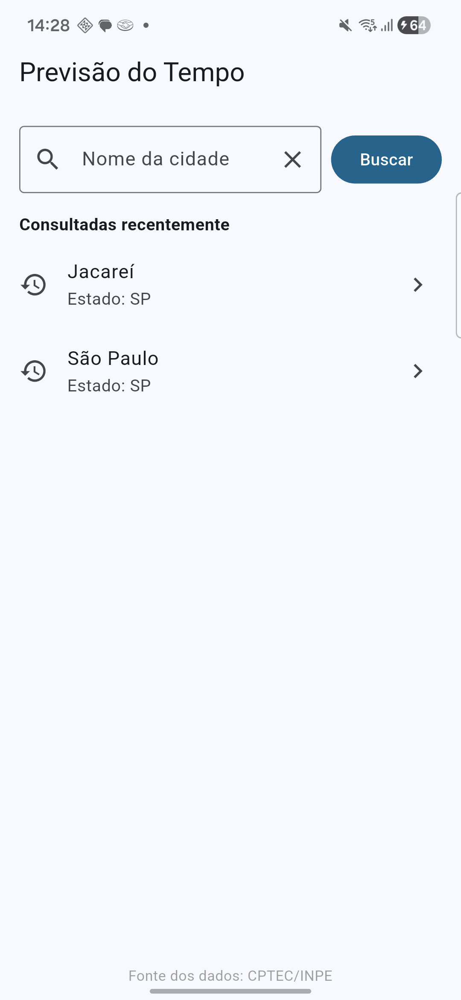
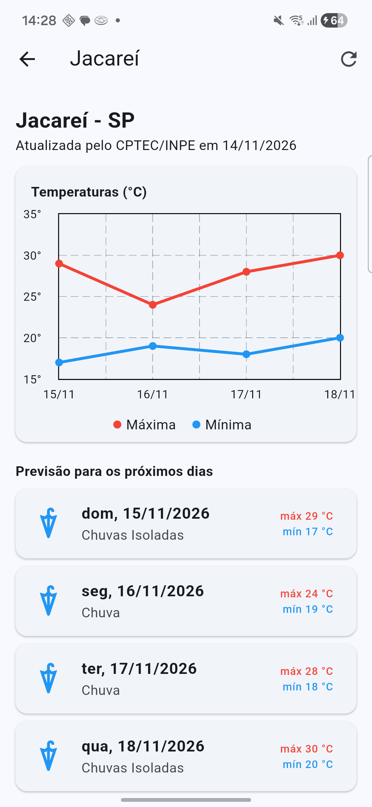
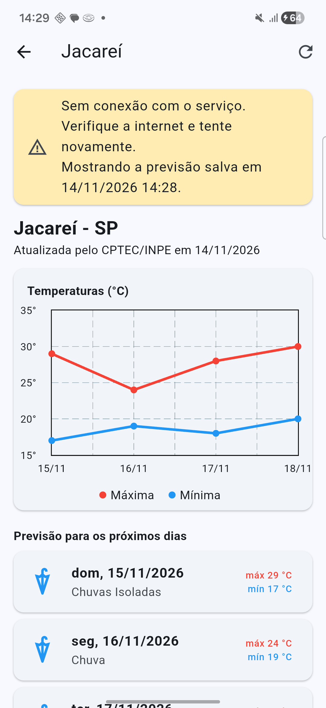

# Previsão do Tempo

Aplicativo Flutter (Android) que consulta a previsão do tempo de cidades brasileiras usando o serviço XML do [CPTEC/INPE](https://servicos.cptec.inpe.br/XML/).

Atividade 2 – Previsão do tempo · Programação para Dispositivos Móveis II · Prof. Arley · FATEC Jacareí

**Autor:** Carlos Eduardo da Silva Magalhães

## Funcionalidades

- **Pesquisa de cidades** pelo nome (com ou sem acento), mostrando cidade e UF. O código usado na previsão é o `id` devolvido pelo próprio serviço.
- **Previsão para 4 dias** com data, temperaturas mínima e máxima (°C), descrição da condição do tempo, ícone e índice ultravioleta (quando disponível).
- **Data de atualização** informada pelo serviço.
- **Gráfico** de linhas com as temperaturas máximas e mínimas.
- **Atualizar** a previsão pelo botão da barra superior.
- **Indicador de carregamento** durante as consultas.
- **Mensagens** para nenhuma cidade encontrada, falha de conexão, serviço indisponível, resposta inválida e previsão indisponível. Campos ausentes no XML não encerram o app.
- **Cidades consultadas recentemente** na tela inicial.
- **Funcionamento sem conexão:** mostra a última previsão salva da cidade, com aviso.
- **Fonte dos dados:** CPTEC/INPE, identificada nas duas telas.

## Como executar

Pré-requisitos: Flutter instalado e um celular ou emulador Android.

```bash
flutter pub get
flutter run
```

## Bibliotecas utilizadas

| Pacote | Uso |
|---|---|
| [http](https://pub.dev/packages/http) | Requisições HTTP ao serviço do CPTEC/INPE |
| [xml](https://pub.dev/packages/xml) | Leitura das respostas em XML |
| [sqflite](https://pub.dev/packages/sqflite) e [path](https://pub.dev/packages/path) | Banco SQLite local |
| [fl_chart](https://pub.dev/packages/fl_chart) | Gráfico de temperaturas |

## Persistência local

O app usa **SQLite** (`previsoes.db`), com a tabela `previsoes_salvas`:

| Coluna | Tipo | Conteúdo |
|---|---|---|
| `cidade_id` | INTEGER (chave primária) | Código da cidade no CPTEC |
| `nome` | TEXT | Nome da cidade |
| `uf` | TEXT | Unidade da federação |
| `xml` | TEXT | XML da última previsão recebida |
| `salvo_em` | TEXT | Data e hora em que foi salva (UTC, ISO 8601) |

- Cada previsão recebida com sucesso é salva, **substituindo** a anterior da mesma cidade (uma linha por cidade).
- Se a consulta falhar (sem internet ou serviço fora do ar), o app mostra a previsão salva e avisa a data em que ela foi salva.
- A tela inicial lista as 10 cidades consultadas mais recentemente, a partir da mesma tabela.

## Capturas de tela

| Busca | Previsão | Sem conexão |
|---|---|---|
|  |  |  |

## Estrutura

```
lib/
├── main.dart
├── app.dart
└── features/previsao/
    ├── models/          # Cidade, PrevisaoDia, PrevisaoCidade, PrevisaoSalva
    ├── services/        # HTTP, leitura do XML, siglas do tempo, erros
    ├── data/            # Banco SQLite e repositório
    └── presentation/    # Telas, widgets e formatação
```

Dados: © CPTEC/INPE.
